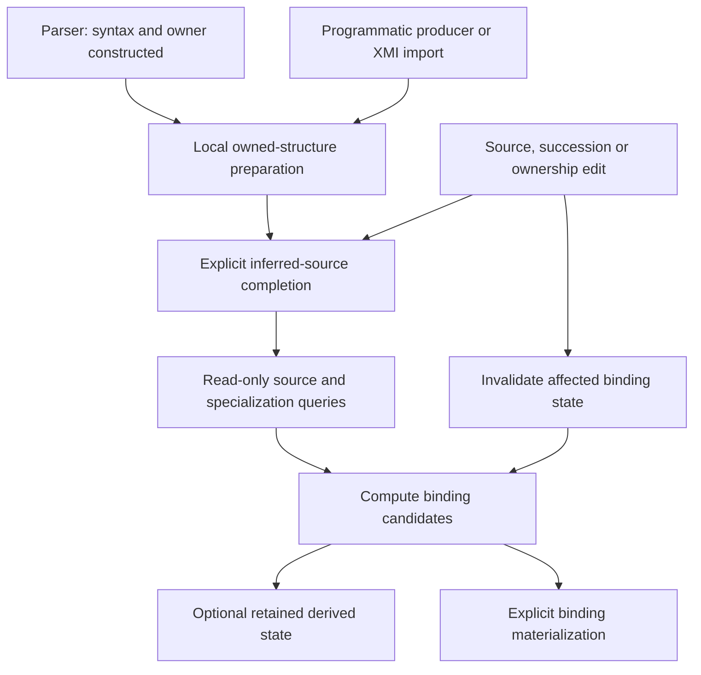

# Transition preparation: baseline and proposed refactoring

## Status and objective

This is the lot 0 sublot after ST6RI-979 (expression results) and ST6RI-981
(feature-chain source targets). This commit adds regression coverage and an
architecture proposal only. Production behavior is unchanged. Review this step
before implementing preparation or changing incremental behavior.

The objective is to remove mutations of transition structure from semantic reads
and cache computations. The prepared elements must keep their identities across
queries; source selection, specializations and binding endpoints must preserve
valid-model semantics. Optional specialization caching must remain usable for
stable library elements while editable models can compute without that cache.

## Functional example

```sysml
state def Machine {
    state off;
    state on;
    transition t first off if true then on;
}
```

The transition selects `off` as its source, has an input parameter representing
that source, and owns a succession leading to `on`. An internal ReferenceUsage
represents the transition link and implicitly redefines
`TransitionPerformances::TransitionPerformance::transitionLink`.
Two binding connectors express equality between:

- The succession and the internal transition-link reference.
- The selected source and the transition's first input parameter.

For shorthand syntax, `state off; if true then on;`, the source is inferred from
lexical context. Two consecutive shorthand transitions following `off` both use
`off`; the second must not select the first transition as its source.

## Specification basis

The locally supplied specification is *Systems Modeling Language v2.1, Beta 2,
Part 1*, `SysML-v2-Release/doc/2a-OMG_Systems_Modeling_Language.pdf`.

- Section 7.18.3 describes shorthand transitions with omitted source, using the
  closest lexically preceding state usage, and also permits the entry action as
  source.
- Section 8.3.18.9 defines `sourceFeature()` by selecting a feature through a
  membership other than a FeatureMembership. Its feature target must be an
  ActionUsage. `deriveTransitionUsageSource` uses that feature target.
- `checkTransitionUsageSuccessionSourceSpecialization` connects the succession's
  source to the transition source.
- `checkTransitionUsageSourceBindingConnector` requires a binding between the
  transition source and its first input parameter.
- `checkTransitionUsageSuccessionBindingConnector` requires a binding between the
  succession and the inherited transition-link feature.
- Section 8.4.14.3 explains the parsed memberships and their semantic relationships.

The internal owned link reference is the implementation's representation of the
inherited transition-link feature; the binding constraints do not require getters
to create that reference. The current previous-feature search is broader than the
state-shorthand description: it also serves action transitions and examines
aliases. Do not replace it with a simple previous-state lookup without analyzing
those cases. This baseline does not change interpretation of the specification.

## Actual call paths and mutation boundaries

| Responsibility | Current code | Effect |
|---|---|---|
| Public source query | `TransitionUsage_source_SettingDelegate` -> `sourceFeature()` -> `UsageUtil.getSourceFeatureOf` | Calls `NamespaceUtil.addAdditionalMembersTo` before selecting a source; may resolve membership and feature-chain references. |
| Inferred source membership | `TransitionUsageAdapter.computeSource` | Inserts a Membership at index zero when needed, or fills the first empty membership with the previous eligible feature. |
| Previous eligible feature | `UsageUtil.getPreviousFeature` | Scans the owning type's preceding memberships, resolving member elements and excluding parameters, transitions and most connectors. |
| Owned transition-link reference | `TransitionUsageAdapter.computeTransitionLinkConnectors` | Creates a ReferenceUsage through `TypeUtil.addOwnedFeatureTo` when a succession exists and no link is found. |
| Binding candidates | The same method -> `TypeAdapter.addBindingConnector` | Creates detached connectors with virtual context; stores them in adapter lists. This is not yet owned-model materialization. |
| Link specialization | `SysMLStateRules.transitionLinkRedefinition` | Computes the implicit redefinition of the owned link to the library feature. |
| Transition default and payload | Other `SysMLStateRules` rules | Compute defaults from source/owner and payload relationships; may re-enter source queries. |
| Explicit materialization | `ElementUtil.transformAll(..., true)` and `TypeUtil.insertImplicitBindingConnectors` | Inserts computed binding connectors into the owned model. |

`addAdditionalMembers` computes the source before the link and bindings. It has a
`try/finally` recursion guard around connector computation. The nested call
`computeTransitionLinkConnectors -> getSource -> addAdditionalMembers` is real:
a transition with a parameter but no succession must terminate even when no source
is available. Removing the guard before separating the responsibilities would
reintroduce that recursion.

`clearCachesOf` clears derived membership/type caches but does not clear the
adapter's binding lists. `cleanImplicitBindingConnectors` explicitly clears those
lists. Removing the adapter also loses them. None of these operations removes the
already owned ReferenceUsage.

## Why a direct parser move is insufficient

The current implementation computes both bindings only inside the branch where
`getTransitionLinkFeatureOf` is null. The owned link thus doubles as a completion
flag for semantic computation, although it is persistent model structure and the
connectors are adapter state.

Consequences inferred directly from that control flow:

- Preparing the reference in the parser would cause the existing connector method
  to skip both bindings.
- After binding-list invalidation or adapter removal, an existing reference can
  prevent the bindings from being rebuilt.
- Retargeting an explicit source updates `getSource()` but does not by itself
  rebuild stored binding endpoints.
- A transition without a succession can calculate source bindings without ever
  creating a link reference; repeated consultation can add duplicates.
- Once an inferred source membership is filled, reordering siblings does not
  recompute that source merely by clearing derived caches.

These are lifecycle risks, not desired semantics to preserve in assertions.
The baseline source-edit test checks source selection and structural identities;
it does not claim that stored connectors refresh after that edit. Existing-link
coverage likewise tests preservation, not successful reconstruction of bindings.
Dedicated reproductions and fixes belong in the reviewed implementation step.

## Proposed architecture for review

Use existing utilities, parser post-processors and adapter APIs. A new global
service, dependency registry or blanket cache invalidation mechanism is not needed.
Separate three operations instead of moving the complete adapter method.

1. **Prepare owned structure explicitly.** A small utility called from a
   transition-specific parser post-processor prepares the source-membership slot
   for shorthand syntax and the link reference when a succession is locally
   present. Preserve explicit source memberships, including owned feature chains,
   existing link references, names and parameter order. Read stored relationships,
   without calling `getSource`, inferred types or specialization targets. Expose
   the same operation to programmatic/XMI producers. Missing operands remain
   incomplete until the producer prepares them again.
2. **Complete inferred source selection explicitly.** Source selection depends on
   the owner and preceding members, not just the transition's own structure.
   Preserve the existing selection semantics at an explicit preparation/linking
   boundary, rather than storing an inferred source during a getter. The normal
   shorthand case can use already constructed preceding owned elements. Cases
   involving aliases or feature chains must not force their resolution during the
   early local pass. Their completion order needs focused tests before choosing
   the exact integration hook. A post-resolution-only pass may be too late if
   transition source information is itself needed for scope resolution.
3. **Compute binding candidates independently of structural existence.** Move the
   two binding computations out of the link-creation condition. Reuse the existing
   connector builder and virtual context, and distinguish computed candidates from
   explicit insertion into model containment. Bindings must be rebuildable with
   an existing link. Guard reentrancy with `finally`; do not publish a partial
   recursive result as a complete cache entry. Define how transition-owned binding
   candidates are replaced without erasing unrelated connectors.



The diagram is a proposed dependency order, not an implemented callback sequence.
The existing specialization service may compute uncached; binding lists currently
remain adapter-owned state and are not controlled by that service's cache policy.
This refactoring must not claim that all connector caching has become optional.

## Incremental contract and review decisions

- A target/source reference edit must preserve prepared structural identities.
  Recomputed binding endpoints must use the new source/succession.
- A moved shorthand transition needs source re-completion in its new owner/order.
  The implementation must distinguish inferred sources from explicit ones: the
  current filled Membership contains no dedicated provenance. Decide whether the
  parser/editor supplies the inferred source to a dedicated operation, or whether
  a persisted marker is necessary; do not introduce a marker or overwrite an
  explicit source silently.
- Source selection must continue to support source feature chains and entry
  actions. Local structure preparation must not force their referents to resolve.
- XMI import must distinguish already prepared structure from missing derived
  connector state. Preserved link identity cannot suppress connector computation.
- A succession removed temporarily must not cause getters to create replacement
  structure. Completion of an editor operation, rather than a read, owns repair.
- Cached and uncached specialization paths must agree on source/link semantics.
  Performance equivalence is still to be measured when benchmarks are authorized.

Before implementation, validate the source-completion hook and provenance choice
against lexical ordering, unresolved aliases and incremental moves. The binding
lifecycle split is required even for a change limited to parser preparation of the
link reference. This is the principal difference from ST6RI-979 and ST6RI-981.

## Regression coverage and next checks

`TransitionConsultationTest` adds five baseline scenarios:

- Explicit cached state transition: exact binding endpoints, link redefinition,
  repeated queries, cache clearing and repeated materialization.
- Two shorthand transitions, queried in reverse order, including a self-loop.
- Detached incomplete transition with an input: reentrant reads terminate and
  attachment supplies the source without replacing the membership or input.
- Explicit source edits preserve prepared identities and state-transition defaults.
- Producer-supplied link preservation.

Existing `TransitionUsageAdapterTest`, `VirtualContainerTest`,
`FeatureRedefinitionImplicitSpecializationTest` and
`DefaultKeyRelationshipImplicitSpecializationTest` complement this coverage for
payload chains, recursion and specializations. The two placeholder binding tests
in `SysMLImpliedRelationsTest` remain ignored; the new test exercises concrete
binding endpoints instead.

Implementation acceptance must additionally cover: unresolved source feature
chains/aliases; entry and action transitions; reconstruction after adapter removal
and XMI loading; binding refresh after source/succession edits; repeated queries
without a succession; exception recovery; and no containment mutation on reads.
Do not weaken the baseline endpoint assertions to accommodate an architecture.

No benchmark is run at the user's request. Production changes await review.

## Baseline validation

On 2026-10-13, root `mvn clean verify` succeeded in 13 min 46 s: 1677 tests
reported, no failures or errors, 22 skipped. The five new scenarios also passed
in a separate focused JUnit run. Both bundled JARs are from the successful full
build. One existing priority-feature suite took substantially longer than in
previous runs; no runtime performance conclusion is drawn from build duration.
No benchmark was run.
