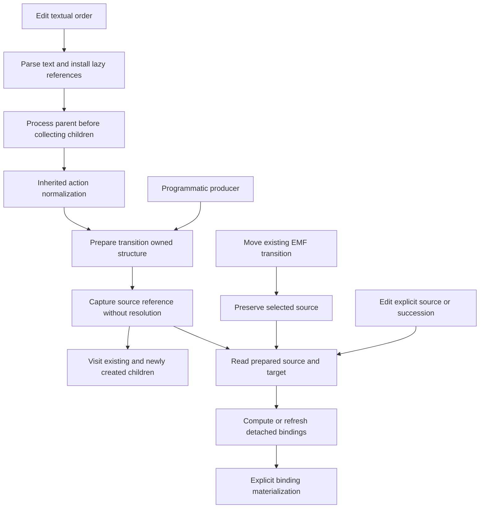

# Transition preparation

## Objective and contract

ST6RI-982 is a lot 0 sublot following ST6RI-979 (expression results) and ST6RI-981
(feature-chain source targets). It separates explicit preparation of transition
structure from semantic consultation and detached binding computation.

A prepared transition retains its source membership and transition-link reference.
Reading its source, target, memberships or implicit specializations does not
create these elements. Specialization caching remains optional; this change does
not make all adapter caches optional.

For a textual shorthand transition, source selection is an interpretation of the
text at preparation time. Once selected, the source is a stored reference:

- Moving the existing EMF transition preserves that reference.
- Editing the textual position can reconstruct the transition through Xtext; the
  new object is prepared from its new lexical context.
- Changing an explicit source reference changes the derived source and the
  endpoints of subsequently requested detached bindings.

No provenance marker or dependency registry is introduced. Source completion does
not overwrite a non-null reference, including an unresolved explicit proxy.

## Functional example

```sysml
state def Machine {
    state off;
    if true then on;
    state on;
}
```

Preparation selects `off` as the source. The target is explicitly named by
`then on`; the implementation does not reinterpret target shorthand for general
successions in this sublot.

Moving the same transition object after `on` in a graphical model keeps the
meaning `off -> on`. Its explicit textual equivalent at that location is:

```sysml
state def Machine {
    state off;
    state on;
    transition first off if true then on;
}
```

Moving the original shorthand *text* after `state on;` instead gives `on -> on`.
The incremental parser test checks this distinction. Text serialization of a
moved graphical model must preserve the selected endpoints; serializer changes
are not part of this implementation.

A transition also has an input parameter representing its source and an internal
ReferenceUsage representing the transition link. The latter implicitly redefines
`TransitionPerformances::TransitionPerformance::transitionLink`. Two bindings
relate the succession to that link, and the selected source to the first input.

## Specification basis

The reference is *Systems Modeling Language v2.1, Beta 2, Part 1*, in
`SysML-v2-Release/doc/2a-OMG_Systems_Modeling_Language.pdf`.

- Section 7.18.3 describes shorthand transitions with omitted source, using the
  closest lexically preceding state usage, and permits the entry action as source.
- Section 8.3.18.9 defines `sourceFeature()` through a membership other than a
  FeatureMembership whose feature target is an ActionUsage.
- `checkTransitionUsageSuccessionSourceSpecialization` connects the succession's
  source to the transition source.
- `checkTransitionUsageSourceBindingConnector` requires a binding between the
  transition source and its first input parameter.
- `checkTransitionUsageSuccessionBindingConnector` requires a binding between the
  succession and the inherited transition-link feature.
- Section 8.4.14.3 describes the parsed memberships and their semantic relationships.

The previous-feature search retains the existing implementation: it examines
preceding memberships, including aliases, and excludes parameters, transitions
and most connectors. It is not narrowed to state usages. Parser preparation does
not replace the semantic implicit-specialization rules for source chains, the
succession ends or the link reference.

## Implementation and call order

| Responsibility | Implementation | Contract |
|---|---|---|
| Ordinary syntax normalization | Existing parser post-processors | Sets parameter directions, end flags and other local syntax properties. |
| Traversal | `ParentFirstTreeIterator`, returned by `KerMLLinker.getAllLinkableContents` | Includes the root, then visits descendants in depth-first containment order. Captures each parent's children on the next `next()` call, including children added during processing. |
| Transition preparation boundary | `TransitionUsageParserPostProcessor` | Runs inherited action normalization, prepares local structure, then captures the source reference without resolving it. |
| Owned structure | `TransitionUtil.prepareStructure` | Creates a missing source-membership slot and a link when a locally owned succession exists. Does not resolve references. Preserves existing elements. |
| Textual source preparation | `TransitionUtil.prepareSourceReference` | Fills an empty source slot from preceding stored memberships. Retains a preceding proxy for normal linking. |
| Programmatic source completion | `TransitionUtil.completeSource` | Uses the existing resolving previous-feature search when a producer explicitly requests semantic completion. |
| Source query | `UsageUtil.getSourceFeatureOf` | Selects the stored source feature without asking the adapter to prepare members. May resolve existing references. |
| Binding computation | `TransitionUsageAdapter` | Computes detached candidates independently of link creation; refreshes candidates when endpoints change. |
| Implicit link redefinition | `SysMLStateRules.transitionLinkRedefinition` | Computes the link's specialization without creating the link. |
| Materialization | `TypeUtil.insertImplicitBindingConnectors` | Explicitly inserts candidates into model containment and clears the detached lists. |



The shared parser traversal uses `ParentFirstTreeIterator` from the logic module's
`org.omg.sysml.util` package. `KerMLLinker.getAllLinkableContents` returns this
iterator for both Xtext's lazy-link installation traversal and parser
post-processing. The latter retains an ordinary iterator loop.

The iterator includes the root and defers capturing each returned object's
children until the following `next()` call. It then pushes those children in
reverse containment order onto an explicit stack. This preserves depth-first
visitation without recursive Java calls, lets a transition prepend its source
membership without skipping succession ends, and includes newly created children
in their own post-processing.

An EMF `AbstractTreeIterator` prepares its child iterator before returning the
parent, so modifying the parent's children during processing can disrupt that live
iterator. `ParentFirstTreeIterator.hasNext()` only checks availability and never
captures children; even an intervening availability check does not freeze the
current parent's child list. `prune()` skips the last returned object's descendants
while preserving its queued siblings. Iterator removal is unsupported.

This contract is local: changes to ancestors or already queued siblings are not
reflected in captured child lists, and moving queued objects is unsupported.
Transition preparation needs no separate `SysMLLinker` pass.

The parser source pass uses non-resolving access to stored membership targets.
For `first A; if ... then B;`, it copies the preceding source reference, including
its Xtext proxy, into the source membership. Ordinary linking later resolves that
reference in its original context. It must not resolve `A` during preparation:
`DecisionTest.sysml.xt` loads its model before its library resources, and early
resolution can invoke decision-specialization rules without the required library
features. This case is covered both by the unchanged Xpect test and by a focused
test asserting that the source remains a proxy after parsing.

For known owned features, the parser applies the same eligibility exclusions as
the existing previous-feature search. For an unresolved reference in the syntactic
source position, it defers semantic classification to linking. The resolving
`completeSource` helper remains available to programmatic producers that need to
classify arbitrary preceding aliases rather than interpret textual source syntax.

## Programmatic and XMI producers

After constructing the transition and establishing its ownership, a producer calls:

```java
TransitionUtil.prepareStructure(transition);
TransitionUtil.completeSource(transition);
```

Both operations are idempotent for already prepared structure. A detached or
incomplete transition may retain a null source; getters do not repair it. After
attaching it or providing missing context, its producer explicitly calls source
completion again. An explicitly selected source need not be recompleted.

A prepared XMI model retains its source membership and link without running a
parser. A textual importer must resolve textual proxies before transferring the
model to another resource or changing their lookup context; preparing structure
does not replace that normal import/linking step. Detached bindings are reconstructed from that structure as needed.
Unprepared programmatic or XMI models must use the preparation operations; a
semantic query is no longer a substitute for import preparation.

## Binding lifecycle and recursion

The adapter retains its two candidates separately from the owned link. For each
request, it compares their explicit endpoints with the current source/input and
succession/link. Unchanged candidates retain their identities. A changed or
missing endpoint replaces or removes only the corresponding transition candidate;
other bindings in the inherited adapter lists are preserved.

Clearing the binding lists resets these candidate references. Removing the adapter
also discards them. Either operation permits reconstruction even though the owned
link still exists. Existing implied, materialized bindings with matching endpoints
are recognized, avoiding duplicate insertion after a new adapter is installed.

The reentrancy guard is always released in `finally`. Recursive computation leaves
the active calculation to its outer call; no persistent completion flag is set
from a partial result. After an exception, another request can retry.

This is still adapter-retained binding state, independent of the specialization
service's cache policy. Candidate computation can resolve references and update
adapter state, but does not append source memberships or link references to the
owned model. Generated connector ends and their relationships belong to detached
candidates until explicit materialization.

## Limits and remaining integration work

- Parser preparation does not resolve preceding source references. A programmatic
  producer may explicitly choose the resolving `completeSource` operation after
  establishing its model and library context. Tests do not exhaust every possible
  cross-resource cycle or incomplete editing state.
- Explicit source and succession edits refresh detached bindings. Editing a
  transformed model does not automatically remove or rewrite already materialized
  implied connectors. That remains the responsibility of the editing/transformation
  lifecycle; semantic reads do not mutate them.
- A source intentionally cleared to null may be filled on a subsequent explicit
  completion call. Moving a transition with a non-null source does not clear it.
- General succession target shorthand is unchanged. This sublot covers
  TransitionUsage preparation, not all succession preparation.
- No end-to-end Eclipse UI, SysON import workflow or textual serialization round
  trip was exercised here. The incremental tests use `XtextResource.update`.
- No performance equivalence claim is made without measurement. No benchmark is
  run at the user's request.

## Regression coverage

`TransitionConsultationTest` covers:

- Explicit cached transitions: endpoints, link redefinition, stable candidates,
  cache clearing and repeated materialization.
- Consecutive shorthand transitions, reverse consultation and self-loops.
- Detached incomplete construction and explicit completion after attachment.
- Explicit source edits and preservation of prepared structure.
- Producer-supplied links and reconstruction of their bindings.
- EMF movement preserving endpoints and incremental textual edits selecting new ones.
- Containment notifications during semantic queries, binding-list clearing and
  adapter replacement.
- Prepared XMI round trips.
- Preservation of unresolved explicit source proxies and lazy preceding `first` references.
- Entry actions, aliases and source feature chains.
- Action transitions.
- Succession replacement, removal and restoration.
- Reentrant binding computation, exception recovery and absence of duplicates.

The original detached-construction regression now invokes preparation explicitly:
this is the intentional lifecycle change. Its source, input and membership identity
assertions are retained. Existing-link coverage replaces the parser-prepared link
with a producer-supplied one before checking preservation and bindings.

`ParserPostProcessorTraversalTest` additionally checks prepended and appended
children, preservation of existing siblings, and descendants created while
processing initially empty parents. Each element is visited once in containment
order, and added nodes receive their real parser normalization.

Seven `ParentFirstTreeIteratorTest` unit tests independently cover root inclusion,
containment order, additions after availability checks, children added to leaves,
removal before advancing, pruning, iterator boundary contracts and deep containment.
They use a small Ecore containment tree without parsing or loading libraries.

## Validation

The earlier full build exposed early source resolution in `DecisionTest.sysml.xt`.
Retaining lazy first-source references addressed this without changing Xpect
expectations. On 2026-10-14, the final root `mvn clean verify`
succeeded in 11 min 10 s: 1689 tests reported, no failures or errors, 22 skipped.
This includes all 15 transition tests and the two traversal regressions.
Both bundled JARs match the artifacts produced by this build. Copyright headers
and the final diff were checked.

The previous full build took 10 min 06 s; this run took 64 seconds longer and
includes the new traversal test class. These isolated build durations do not
establish the runtime cost of the traversal. No benchmark was run.

Iterator extraction validation on 2026-10-23: root `mvn clean verify` succeeded
in 11 min 03 s (1696 tests reported, no failures or errors, 22 skipped).
All seven iterator unit tests, two parser traversal integration tests and
15 transition tests passed. Both bundled JARs match the rebuilt artifacts.
No benchmark was run.
